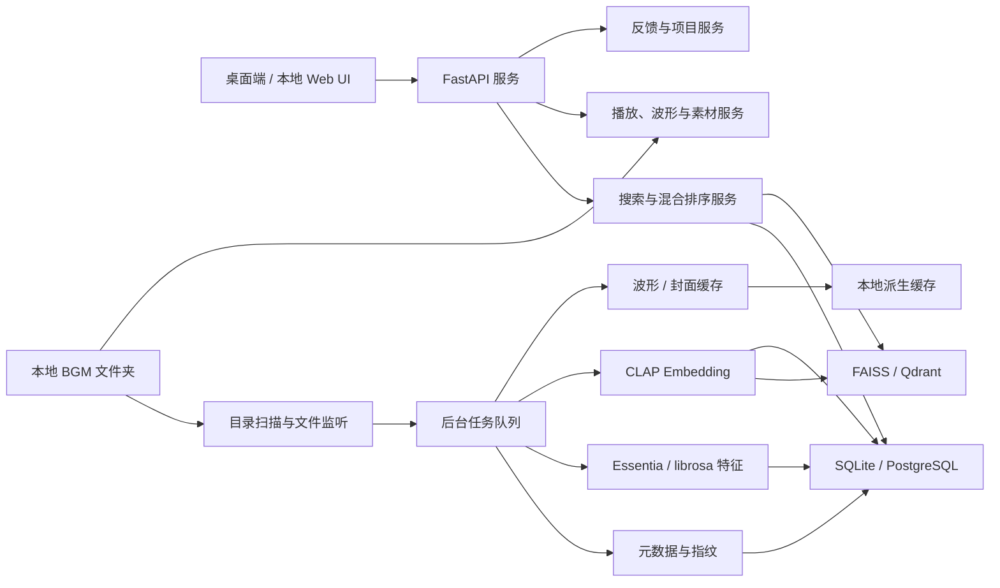

# 影视配音 / 背景音乐本地智能素材库技术方案（V1 + V2 + V3）

> 文档状态：可实施设计稿  
> 目标平台：Windows 本地优先，可选 Docker / 局域网部署  
> 推荐技术栈：Python、FastAPI、SQLite/PostgreSQL、Essentia/librosa、CLAP、FAISS/Qdrant

## 1. 文档目的

本方案面向职业配音、影视后期和音频编辑人员，建设一个以本地文件为资产主体的智能 BGM 素材库。系统不移动或破坏原始音乐文件，通过扫描、特征分析、标签、音频—文本向量和使用反馈，让用户能够按场景、情绪、节奏、乐器、时长等条件快速找到音乐，直接试听，并继续查找相似素材。

本文覆盖从 MVP 到个性化推荐的完整演进路径，可直接用于产品拆分、数据库设计、接口开发和验收。

## 2. 需求背景与目标

### 2.1 当前痛点

- 素材以文件夹、文件名和个人记忆组织；库变大后，定位成本快速上升。
- 工作时的需求通常是“压抑但不要太沉重、慢节奏、适合人物独白”，与文件名不匹配。
- 同一首音乐可能同时属于多个情绪、场景和风格，树形文件夹无法表达多维关系。
- 缺少统一试听、波形定位、收藏、历史使用和相似音乐入口。
- 每次都重新比较大量候选，系统无法学习个人审美和项目偏好。
- 新素材入库依赖手工命名与分类，容易遗漏、重复和标准不一致。

### 2.2 建设目标

1. 对多个本地目录进行只读或受控索引，增量发现新增、修改、移动和删除文件。
2. 自动提取时长、BPM、调性、响度、能量、是否含人声等信息。
3. 建立统一、可编辑、可追溯的中文标签体系。
4. 支持自然语言搜索，例如“克制的悲伤，钢琴为主，适合回忆独白”。
5. 支持上传、拖入或选择一首歌曲查找相似音乐。
6. 支持结构化条件、全文匹配、向量相似度和用户偏好的混合排序。
7. 提供波形试听、快捷跳转、收藏、排除、项目使用记录和反馈闭环。
8. 默认离线运行，原始音频不上传；数据可备份、恢复和迁移。

### 2.3 建议量化指标

- 10 万首以内，普通筛选查询 P95 小于 300 ms；混合查询 P95 小于 1.5 s（向量已生成）。
- 新文件在扫描启动后可见时间小于 60 s；分析任务可后台执行。
- 1000 首库的首次索引可断点续跑，失败不影响其他文件。
- Top 20 人工相关率在内部标准查询集上达到 75% 以上。
- 常用素材查找时间较原流程下降 60% 以上。

## 3. 范围与非目标

### 3.1 范围

- 本地音频目录管理、扫描、指纹和增量索引。
- WAV、MP3、FLAC、M4A/AAC、OGG 等常用格式（以 FFmpeg 解码能力为准）。
- 元数据、技术特征、标签、全文和向量检索。
- 自然语言搜歌、以歌搜歌、相似推荐、筛选和排序。
- 本地 Web/桌面 UI、波形预览、播放队列、收藏和使用反馈。
- 单用户本地模式；V3 可扩展局域网多用户。

### 3.2 非目标

- 不替代 DAW/NLE，不提供专业多轨剪辑、混音和母带功能。
- MVP 不做音乐版权判断、自动采购或云端曲库分发。
- 不承诺模型标签绝对正确；系统必须允许人工修正。
- 不在索引时自动重命名、移动或删除原文件。
- 不用生成式模型自动创作或改编音乐。

## 4. 为什么不能只用一种检索方式

### 4.1 只靠文件夹或标签的问题

文件夹只能表达单一路径，而音乐天然是多维的；“悬疑 + 低能量 + 钢琴 + 独白铺底”不能合理归入唯一目录。纯人工标签还存在入库成本高、词义不一致、漏标，以及新需求无法提前枚举的问题。不过标签和元数据具有可解释、可控、可硬约束的优势，因此不能舍弃。

### 4.2 只靠向量检索的问题

Embedding 擅长判断整体语义或听感相似，但不可靠地保证“时长小于 90 秒”“无人声”“BPM 60–80”等精确条件；还会受模型语种、领域偏差和片段采样影响。纯向量结果难以解释，也难以体现用户明确排除项。

### 4.3 推荐组合

采用三层流水线：

1. **Metadata Filter（硬约束）**：先过滤格式、时长、BPM、人声、目录、授权状态、排除标签等。
2. **CLAP Similarity（语义召回）**：使用文本—音频或音频—音频相似度找到候选。
3. **Preference Rerank（个性化重排）**：结合收藏、试听完成度、项目采用、跳过和屏蔽行为调整顺序。

过滤保证“符合条件”，向量保证“听起来/语义上接近”，偏好保证“更像这个用户会采用的素材”。

## 5. 核心使用流程

### 5.1 首次建库

1. 用户添加一个或多个素材根目录，并设置是否递归、忽略规则和只读策略。
2. 扫描器枚举文件，读取容器元数据并生成快速指纹。
3. 系统写入基础记录，UI 立即可浏览；后台队列继续生成波形、技术特征、标签和向量。
4. 用户查看失败任务，修复解码器或路径后重试。

### 5.2 日常入库

1. 用户把新文件放入受管目录。
2. 文件监听器收到事件，等待文件大小稳定后登记任务。
3. 去重、解析和分析完成，自动标签以“模型建议”状态写入。
4. 用户可批量确认、修改标签；人工值优先于模型值。

### 5.3 搜索与选用

1. 输入自然语言并追加结构化条件。
2. 系统解析硬约束，生成查询向量，分阶段召回和排序。
3. 用户查看解释信息、波形和标签，悬停或快捷键试听。
4. 收藏、加入候选单、标记不相关或记录“已用于项目”。
5. 系统保存隐式与显式反馈，V3 用于重排。

### 5.4 以歌搜歌

从库内歌曲点击“找相似”，或临时拖入参考音频；系统统一采样并生成向量，在结构化过滤后的集合中进行近邻搜索。临时文件仅缓存特征，可按配置自动删除。

## 6. V1 / V2 / V3 功能规划

| 阶段 | 定位 | 核心能力 | 暂不包含 |
|---|---|---|---|
| V1 | 可用的本地素材目录 | 多目录扫描、增量索引、基础元数据、人工标签、过滤/全文搜索、波形试听、收藏、任务状态 | CLAP、个性化 |
| V2 | 智能语义检索 | 技术特征、自动标签、CLAP 音频向量、自然语言搜歌、以歌搜歌、混合排序、搜索解释 | 复杂协同推荐 |
| V3 | 个性化生产工具 | 反馈学习、用户/项目偏好、候选单、项目使用历史、质量评估、可选多用户与局域网服务 | 完整 DAW |

建议先完成 V1 数据底座，V2 模型能力作为异步插件接入，V3 在积累足够真实行为数据后启用；没有行为样本时，个性化权重应为零。

## 7. 总体架构



### 7.1 进程建议

- `api`：FastAPI，负责接口、搜索编排、文件流和权限校验。
- `worker`：执行解码、特征、波形和 Embedding 任务；可按 CPU/GPU 分队列。
- `scheduler`：定时全量校验、缺失文件检查、备份和索引一致性检查。
- `ui`：React/Vue Web UI；桌面版用 Tauri 包装并管理本地服务生命周期。

MVP 可合并为一个进程加后台 worker，后续再拆分。不要让耗时音频分析占用 API 工作线程。

## 8. 技术选型

| 层 | 首选 | 可选/说明 |
|---|---|---|
| 后端 | Python 3.11+、FastAPI、Pydantic、SQLAlchemy/Alembic | API 清晰，音频与机器学习生态成熟 |
| 数据库 | SQLite（V1 单机） | V3 多用户或高并发切 PostgreSQL；业务层避免 SQLite 专有写法 |
| 音频解码 | FFmpeg/ffprobe | 统一输入为 PCM，处理损坏或特殊编码 |
| 特征 | Essentia + librosa | Essentia 用于生产特征，librosa 用于补充/原型验证 |
| 指纹 | SHA-256 + 可选 Chromaprint | SHA-256 判定字节重复；Chromaprint 辅助识别转码重复 |
| Embedding | LAION-CLAP 或兼容 Audio-Text 模型 | 模型版本必须随向量记录；中文查询可模板化/翻译增强 |
| 向量库 | FAISS（单机） | Qdrant 适合持久化过滤、多用户和服务化；小库也可暴力余弦计算 |
| 队列 | SQLite job 表 + 进程池（MVP） | 后续 Celery/RQ + Redis；Windows 下优先独立 worker 进程 |
| 前端 | React + TypeScript + Vite | 波形可用 wavesurfer.js；状态管理可用 Zustand |
| 桌面封装 | Tauri | 安装体积和资源占用通常低于 Electron；也可先浏览器访问 localhost |

## 9. 模块设计

### 9.1 文件源管理

维护根目录、包含格式、排除 glob、递归策略、在线状态和最后扫描游标。所有路径入库前规范化，但同时保存原始显示路径。Windows 使用不区分大小写的规范键，处理盘符、UNC 路径和长路径。

### 9.2 扫描与索引服务

职责包括枚举、稳定性检测、快速指纹、状态对账、任务提交和断点续跑。每次扫描创建 `scan_run`，记录发现、更新、缺失和失败数量。

### 9.3 音频分析服务

将输入解码为统一采样率的单声道 PCM，提取技术特征和分段统计。不同特征步骤独立记录版本和状态，单项失败不阻断基础浏览。

### 9.4 标签服务

管理标签词典、别名、父子关系、来源和置信度；支持人工批量覆盖、锁定和审计。标签来源至少区分 `manual`、`folder_rule`、`filename_rule`、`model`、`import`。

### 9.5 向量服务

负责模型加载、批量推理、归一化、索引构建、增量添加、删除标记和周期压缩。业务数据库是事实源，向量索引可重建。

### 9.6 检索与排序服务

解析查询、构造过滤条件、多路召回、特征归一化、融合、去重、重排和解释。保存查询快照以便离线评测和问题复现。

### 9.7 播放与波形服务

支持 HTTP Range、转码预览、音量归一化预听、波形峰值缓存和快捷键控制。原文件只读；临时转码写入派生缓存。

### 9.8 反馈与偏好服务

接收曝光、播放、播放时长、跳过、收藏、屏蔽、加入候选和项目采用事件，生成用户和项目偏好特征。

## 10. 音频扫描与增量索引

### 10.1 状态机

`DISCOVERED → METADATA_READY → FEATURES_READY → EMBEDDING_READY → READY`。任一步骤可进入 `PARTIAL_FAILED`，记录错误码、重试次数和下一次重试时间。文件缺失标记为 `MISSING`，不立即删除历史数据。

### 10.2 文件身份与变更判断

- 快速键：规范路径 + 文件大小 + 修改时间，用于快速跳过。
- 内容 ID：文件 SHA-256，用于字节级去重。
- 声学指纹：Chromaprint，可识别不同封装/码率的同一录音；仅作为候选重复，避免误删。
- `asset_id` 是稳定内部 ID；文件移动后若内容哈希一致，更新 location 而不创建新资产。

### 10.3 增量算法

1. 枚举文件并批量读取 stat。
2. 新路径：等待大小与修改时间连续两次稳定，再创建资产和任务。
3. 已知路径且快速键未变：跳过。
4. 已知路径发生变化：重新计算哈希；哈希变化则提升 `analysis_revision` 并重建派生数据。
5. 数据库存在但扫描未发现：标记 `MISSING`；连续多次缺失后提示用户归档。
6. 使用文件监听降低延迟，同时保留周期全量扫描修复漏事件。

### 10.4 幂等性

任务唯一键建议为 `(asset_id, task_type, analysis_revision, model_version)`。worker 提交结果时校验 revision，防止旧任务覆盖新文件结果。

## 11. 元数据与标签体系

### 11.1 元数据维度

- 文件：路径、格式、大小、修改时间、哈希、可用状态。
- 音频：时长、采样率、声道、位深、码率、峰值、LUFS。
- 音乐：BPM、拍号、调性/大小调、能量、动态范围、人声概率。
- 语义：情绪、场景、风格、乐器、年代感、叙事功能、适用位置。
- 业务：授权状态、来源、项目、收藏、评分、备注、最后使用时间。

### 11.2 推荐标签命名空间

| 命名空间 | 示例 |
|---|---|
| `mood` 情绪 | 悲伤、克制、温暖、紧张、神秘、庄严 |
| `scene` 场景 | 回忆、离别、追逐、调查、家庭、战争 |
| `function` 叙事功能 | 独白铺底、转场、悬念建立、高潮、片尾 |
| `style` 风格 | 管弦、氛围、电子、爵士、中国风 |
| `instrument` 乐器 | 钢琴、弦乐、木管、合成器、打击乐 |
| `texture` 质感 | 空旷、颗粒、柔和、厚重、极简 |
| `vocal` 人声 | 无人声、吟唱、合唱、歌词人声 |
| `era` 年代感 | 古代、民国、现代、未来 |

标签表使用稳定 code，显示名称可本地化。别名如“忧郁/伤感/悲伤”映射到标准标签，但保留原输入。人工标签可锁定，模型重跑不得覆盖。

## 12. 音频特征提取

### 12.1 基础特征

- `duration_ms`、采样率、声道、码率、编码格式。
- 综合响度 LUFS、true peak、动态范围。
- BPM 与置信度、节拍位置、调性与置信度。
- RMS、谱质心、谱带宽、rolloff、zero-crossing rate、MFCC 统计。
- energy、danceability、acousticness 或领域模型可支持的分类分数。
- vocal probability；低置信度时显示“未知”，不要强制二值化。

### 12.2 分段策略

长音乐只取单个片段会丢失变化。推荐：

- 短于 30 秒：全曲。
- 30 秒至 5 分钟：头部避开静音后、中央、尾部前各取 10–20 秒。
- 更长音频：等距采样 5–8 段。
- 每段单独生成 embedding，并存一条均值归一化的全曲向量；搜索可用最大分段相似度与全曲相似度组合。

所有特征记录 `extractor_version`、参数哈希和生成时间，便于可重复计算。

## 13. Embedding 生成与向量结构

### 13.1 音频向量

使用 CLAP 音频编码器生成 `float32[d]`，L2 归一化后写入索引。若模型维度为 512/768/1024，以实际模型配置为准，不在代码中写死。

### 13.2 文本向量

用户查询进入 CLAP 文本编码器。中文效果应以测试集验证；可采用原始中文、标准标签扩写和可选本地翻译后的英文三路查询，并对结果取最大或加权融合。示例扩写：

```text
原始：克制的悲伤，适合独白
扩写：mood: restrained sadness; low-to-medium energy; background music for monologue; unobtrusive
```

### 13.3 向量记录

```json
{
  "vector_id": 91827,
  "asset_id": "01J...",
  "segment_index": 1,
  "start_ms": 45000,
  "end_ms": 60000,
  "model": "laion-clap",
  "model_version": "pinned-version",
  "dimension": 512,
  "normalized": true,
  "analysis_revision": 3
}
```

FAISS 建议小规模先用 `IndexFlatIP` 获得精确余弦相似度；10 万至百万级再评估 HNSW/IVF。删除采用 tombstone 并定期重建。Qdrant 模式将常用过滤字段作为 payload，但关系数据库仍保存业务事实。

## 14. 搜索方案

### 14.1 查询解析

输入由显式 UI 条件和自然语言组成。显式条件永远优先。自然语言解析可先使用规则词典和正则抽取 BPM、时长、有人声/无人声、乐器等；不确定内容保留为语义文本，不能把模糊推断变成硬过滤。

示例：

```text
“60 到 80 BPM、无人声、钢琴，悲伤但不绝望，适合回忆独白”
```

解析结果：`bpm=[60,80]`、`vocal=false`、`instrument=钢琴` 为硬条件；“悲伤但不绝望，适合回忆独白”参与语义召回。

### 14.2 多路召回

1. 结构化候选集：SQL 元数据过滤。
2. 语义候选：文本向量对音频向量 Top K。
3. 关键词候选：文件名、备注、标签的 FTS/BM25。
4. 以歌搜歌：参考音频向量 Top K。
5. 可选协同候选：相似用户/项目曾采用的素材。

向量库若不支持高效过滤，可先取较大 Top K（如 500–2000）再与 SQL 候选求交；若硬过滤选择性很高，则先获取允许的 asset ID 集合。

### 14.3 归一化与混合打分

建议初始公式：

```text
eligible(a) = 1，当且仅当资产满足所有硬过滤条件

semantic(a) = 0.70 * text_audio_similarity
            + 0.30 * reference_audio_similarity   # 无参考歌时重新归一化

base(a) = 0.55 * semantic_norm
        + 0.20 * metadata_soft_match
        + 0.10 * lexical_norm
        + 0.10 * quality_score
        + 0.05 * freshness_or_diversity

final(a,u,p) = eligible(a) * clamp(
                 base(a)
               + 0.15 * user_preference(u,a)
               + 0.10 * project_preference(p,a)
               - 0.20 * negative_feedback(u,a), 0, 1)
```

权重只是起点，必须通过标准查询集和真实采用率调整。各分值先在当前候选集做稳健归一化，避免不同模型量纲直接相加。显式屏蔽作为硬排除，不仅是负分。

### 14.4 偏好分

冷启动时 `user_preference=0`。有数据后可从标签偏好向量、常用 BPM/能量分布、收藏与采用素材的平均 embedding 构建用户画像：

```text
user_preference = 0.45 * cosine(asset_embedding, user_profile_embedding)
                + 0.35 * preferred_tag_match
                + 0.20 * preferred_feature_likelihood
```

为防止越搜越窄，最终列表应保留约 10%–20% 探索位，并以 MMR 或相似度阈值控制同质结果。

### 14.5 可解释性

每个结果返回简短原因：如“语义相似 0.82；钢琴/无人声命中；BPM 72；你最近 5 次回忆类项目偏好低能量”。这既帮助用户判断，也便于研发定位排序问题。

## 15. 个性化反馈数据

### 15.1 事件设计

| 事件 | 建议信号 |
|---|---:|
| `impression` 曝光 | 0，仅用于计算分母 |
| `play_started` | +0.05 |
| 播放超过 30 秒或 50% | +0.15 |
| `favorite` | +0.6 |
| `added_to_shortlist` | +0.5 |
| `used_in_project` | +1.0 |
| 3 秒内跳过 | -0.15，需考虑误触 |
| `not_relevant` | -0.6 |
| `blocked` | 硬排除 |

事件保存当时的查询、排名、模型版本和项目上下文。隐式行为权重低于显式行为，且按时间衰减。用户应能关闭个性化、清空历史或切换到“纯相关性”。

### 15.2 训练与更新

V3 初期不必训练复杂推荐模型，可每日/每 50 个有效事件更新画像。数据足够后再采用 pairwise learning-to-rank；训练样本可由同一查询中“采用项 > 曝光未选项”构造，并设置最小样本量和验证集，避免小样本过拟合。

## 16. 数据库设计

### 16.1 核心表

| 表 | 关键字段 | 说明 |
|---|---|---|
| `library_root` | id, path, recursive, rules_json, status | 素材根目录 |
| `asset` | id, content_sha256, title, status, analysis_revision | 逻辑音频资产 |
| `file_location` | id, asset_id, root_id, path, size, mtime, available | 一个资产可有多个位置 |
| `audio_metadata` | asset_id, duration_ms, codec, sample_rate, channels, bitrate | 基础音频信息 |
| `audio_feature` | asset_id, bpm, key_name, lufs, energy, vocal_prob, version | 数值特征 |
| `tag` | id, namespace, code, display_name, parent_id | 标签词典 |
| `tag_alias` | tag_id, alias, locale | 同义词 |
| `asset_tag` | asset_id, tag_id, source, confidence, locked | 资产标签 |
| `embedding_ref` | id, asset_id, segment_index, model_version, vector_key | 向量元信息 |
| `collection` / `collection_item` | ... | 收藏夹/候选单 |
| `project` / `project_asset` | ... | 项目使用记录 |
| `search_session` | query, filters_json, weights_json, model_version | 查询快照 |
| `feedback_event` | user_id, asset_id, event_type, context_json, created_at | 行为数据 |
| `job` | type, entity_id, state, attempts, error_code | 后台任务 |
| `scan_run` | root_id, started_at, finished_at, counters_json | 扫描审计 |

### 16.2 示例 DDL（PostgreSQL，SQLite 可做类型适配）

```sql
CREATE TABLE asset (
    id UUID PRIMARY KEY,
    content_sha256 CHAR(64),
    title TEXT,
    status VARCHAR(32) NOT NULL,
    analysis_revision INTEGER NOT NULL DEFAULT 1,
    created_at TIMESTAMPTZ NOT NULL DEFAULT now(),
    updated_at TIMESTAMPTZ NOT NULL DEFAULT now()
);
CREATE UNIQUE INDEX ux_asset_sha256
    ON asset(content_sha256) WHERE content_sha256 IS NOT NULL;

CREATE TABLE file_location (
    id BIGSERIAL PRIMARY KEY,
    asset_id UUID NOT NULL REFERENCES asset(id),
    root_id BIGINT NOT NULL,
    path TEXT NOT NULL,
    normalized_path TEXT NOT NULL UNIQUE,
    size_bytes BIGINT NOT NULL,
    modified_ns BIGINT NOT NULL,
    available BOOLEAN NOT NULL DEFAULT TRUE,
    last_seen_at TIMESTAMPTZ NOT NULL DEFAULT now()
);

CREATE TABLE audio_feature (
    asset_id UUID PRIMARY KEY REFERENCES asset(id),
    bpm REAL,
    bpm_confidence REAL,
    key_name VARCHAR(16),
    key_confidence REAL,
    integrated_lufs REAL,
    energy REAL,
    vocal_probability REAL,
    extractor_version TEXT NOT NULL,
    updated_at TIMESTAMPTZ NOT NULL DEFAULT now()
);

CREATE TABLE asset_tag (
    asset_id UUID NOT NULL REFERENCES asset(id),
    tag_id BIGINT NOT NULL REFERENCES tag(id),
    source VARCHAR(32) NOT NULL,
    confidence REAL,
    locked BOOLEAN NOT NULL DEFAULT FALSE,
    PRIMARY KEY (asset_id, tag_id, source)
);
```

### 16.3 示例查询

```sql
SELECT a.id, a.title, f.bpm, f.energy
FROM asset a
JOIN audio_feature f ON f.asset_id = a.id
JOIN audio_metadata m ON m.asset_id = a.id
WHERE a.status IN ('READY', 'FEATURES_READY')
  AND f.bpm BETWEEN :bpm_min AND :bpm_max
  AND f.vocal_probability < :vocal_threshold
  AND m.duration_ms <= :max_duration_ms
  AND EXISTS (
      SELECT 1 FROM asset_tag atg
      JOIN tag t ON t.id = atg.tag_id
      WHERE atg.asset_id = a.id
        AND t.namespace = 'instrument'
        AND t.code = 'piano'
  );
```

SQLite 使用 WAL、外键约束和 FTS5。大批写入需分批事务；避免每个文件单独提交。

## 17. API 设计

统一前缀 `/api/v1`，错误格式包含 `code`、`message`、`details`、`request_id`。

### 17.1 主要接口

| 方法 | 路径 | 用途 |
|---|---|---|
| POST | `/libraries` | 添加素材目录 |
| POST | `/libraries/{id}/scans` | 启动扫描 |
| GET | `/scans/{id}` | 扫描进度 |
| GET | `/assets` | 浏览和结构化过滤 |
| GET | `/assets/{id}` | 资产详情 |
| PATCH | `/assets/{id}` | 修改标题、备注等 |
| PUT | `/assets/{id}/tags` | 更新人工标签 |
| POST | `/search` | 混合搜索 |
| POST | `/search/similar` | 以歌搜歌 |
| GET | `/assets/{id}/stream` | Range 音频流 |
| GET | `/assets/{id}/waveform` | 波形峰值 |
| POST | `/feedback/events` | 上报反馈 |
| GET/POST | `/collections` | 收藏夹/候选单 |
| GET | `/jobs` | 任务状态和失败信息 |
| POST | `/jobs/{id}/retry` | 重试任务 |

### 17.2 混合搜索请求

```http
POST /api/v1/search
Content-Type: application/json
```

```json
{
  "query": "克制的悲伤，适合回忆中的人物独白",
  "filters": {
    "bpm": {"min": 60, "max": 85},
    "duration_ms": {"max": 180000},
    "vocal": "instrumental",
    "include_tags": ["instrument:piano"],
    "exclude_tags": ["mood:epic"]
  },
  "reference_asset_id": null,
  "sort_mode": "personalized",
  "page_size": 20,
  "cursor": null
}
```

响应：

```json
{
  "search_id": "01JSEARCH...",
  "items": [
    {
      "asset_id": "01JASSET...",
      "title": "Memory Piano 07",
      "duration_ms": 124000,
      "bpm": 72.1,
      "tags": ["悲伤", "克制", "钢琴", "独白铺底"],
      "score": 0.864,
      "score_parts": {
        "semantic": 0.88,
        "metadata": 1.0,
        "preference": 0.61
      },
      "reason": "语义高度相似；钢琴、无人声和 BPM 条件命中",
      "stream_url": "/api/v1/assets/01JASSET.../stream"
    }
  ],
  "next_cursor": "opaque-token",
  "took_ms": 182
}
```

### 17.3 反馈请求

```json
{
  "event_type": "used_in_project",
  "asset_id": "01JASSET...",
  "search_id": "01JSEARCH...",
  "project_id": "01JPROJECT...",
  "position": 3,
  "playback_ms": 67000,
  "client_time": "2026-10-06T12:30:00+08:00"
}
```

接口必须拒绝不在已配置根目录中的任意路径，避免路径穿越和本地文件泄露。

## 18. 前端与桌面端方案

### 18.1 页面布局

```text
┌ 左侧：素材库/收藏夹/项目 ┬ 顶部：自然语言搜索 + 高级筛选 ┐
│ 根目录与扫描状态         │                                   │
│ 情绪/场景/乐器快捷入口   ├ 结果区：列表/卡片、排序解释       │
│                          │                                   │
├──────────────────────────┴───────────────────────────────────┤
│ 底部固定播放器：波形、播放、A/B、音量、入点/出点、找相似    │
└──────────────────────────────────────────────────────────────┘
```

详情抽屉展示路径、技术参数、标签来源、相似曲和使用历史。结果列表支持键盘上下选择、空格播放、数字键评分、快捷收藏；连续试听时自动停止上一首。

### 18.2 波形试听

- 后台预计算每声道或混合声道的 min/max peaks，保存压缩 JSON/二进制缓存。
- 客户端只加载峰值和当前所需音频 Range，不下载完整大文件。
- 可显示静音段、节拍点和分段 embedding 区间。
- 原始响度差异较大时提供“仅试听归一化”，不得修改原文件。
- 可选设置 5–15 秒快捷预听点，优先从非静音、高信息密度片段开始。

## 19. 任务队列与并发处理

任务类别：`probe`、`hash`、`fingerprint`、`waveform`、`features`、`embedding`、`auto_tag`、`index_sync`。

- I/O 任务可使用线程池；解码/DSP 使用进程池；GPU embedding 采用单独批处理 worker。
- 每类任务设置独立并发数，防止机械硬盘随机读取过载。
- 支持暂停、继续、取消、指数退避重试和失败队列。
- 用户正在试听时降低后台磁盘和 CPU 优先级。
- GPU 推理按相似时长分桶批处理，发生显存不足时减小 batch 并重试。
- 优先级：用户即时“找相似” > 新增文件基础元数据 > 波形 > 特征 > 全库 embedding 重建。

## 20. 模型与硬件要求

### 20.1 最低配置

- Windows 10/11 64 位，4 核 CPU，16 GB 内存。
- 模型、缓存和数据库预留 10–30 GB；音频文件空间另计。
- 无独显可运行，但首次 embedding 建库较慢。

### 20.2 推荐配置

- 8 核以上 CPU、32 GB 内存、NVMe 缓存盘。
- NVIDIA 8 GB 以上显存用于批量 CLAP 推理；也应支持 CPU 回退。

### 20.3 模型治理

- 固定模型文件校验和、版本、推理库版本和预处理参数。
- 模型升级新建索引，不在原索引混用不同版本。
- 提供模型下载进度、离线导入和许可证说明。
- 自动标签阈值按标签校准；低置信度不展示或标为建议。

## 21. Windows 本地部署

### 21.1 推荐交付形态

使用 Tauri 安装包包含 UI 和服务启动器；Python 后端可用独立运行环境或打包可执行程序。首次启动执行：

1. 检查 FFmpeg 和模型文件。
2. 创建 `%LOCALAPPDATA%/BgmLibrary/` 下的数据库、索引、缓存和日志目录。
3. 运行数据库迁移。
4. 仅监听 `127.0.0.1` 随机或配置端口，生成本机会话令牌。
5. 打开桌面窗口并进行健康检查。

Windows 注意事项：长路径、中文路径、UNC/NAS 断线、OneDrive 占位文件、防病毒软件锁文件、睡眠唤醒后目录句柄失效。扫描逻辑应允许文件暂时被占用并延迟重试。

### 21.2 升级与卸载

应用升级前备份数据库并验证迁移；模型和索引与应用版本解耦。卸载默认保留数据库与用户标签，明确提供“同时删除缓存/索引”的选项，原始音频永不删除。

## 22. Docker 可选部署

适用于开发、NAS 或局域网共享：

```yaml
services:
  api:
    image: bgm-library:latest
    ports: ["127.0.0.1:8765:8000"]
    volumes:
      - ./data:/app/data
      - D:/BGM:/music:ro
    environment:
      BGM_DATABASE_URL: postgresql+psycopg://bgm:change-me@db/bgm
  worker:
    image: bgm-library:latest
    command: ["python", "-m", "app.worker"]
    volumes:
      - ./data:/app/data
      - D:/BGM:/music:ro
  db:
    image: postgres:16
    volumes: ["./postgres:/var/lib/postgresql/data"]
```

生产环境不要把服务直接暴露到公网；音频卷使用只读挂载。GPU worker 需单独配置 NVIDIA Container Toolkit。Windows Desktop 首选原生部署，Docker 作为可选项而非 MVP 前置依赖。

## 23. 推荐目录结构

```text
bgm-library/
├─ app/
│  ├─ api/                 # 路由、DTO、错误处理
│  ├─ domain/              # 资产、标签、搜索领域逻辑
│  ├─ services/            # 扫描、分析、检索、反馈
│  ├─ workers/             # 后台任务入口
│  ├─ models/              # ORM 与迁移
│  ├─ vector/              # FAISS/Qdrant 适配器
│  └─ core/                # 配置、日志、安全
├─ frontend/               # React/Tauri
├─ migrations/
├─ tests/
│  ├─ unit/
│  ├─ integration/
│  ├─ e2e/
│  └─ fixtures/audio/
├─ scripts/                # 诊断、迁移、重建索引
├─ config/
├─ models/                 # 本地模型（通常不入 Git）
└─ docs/
```

## 24. 配置文件示例

```yaml
app:
  host: 127.0.0.1
  port: 8765
  locale: zh-CN

storage:
  database_url: sqlite:///data/library.db
  vector_backend: faiss
  vector_path: data/index/clap.faiss
  cache_dir: data/cache

scanner:
  extensions: [wav, mp3, flac, m4a, aac, ogg]
  ignore: ["**/.git/**", "**/tmp/**", "**/~*"]
  stable_wait_seconds: 5
  full_rescan_hours: 24

analysis:
  ffmpeg_path: tools/ffmpeg.exe
  worker_processes: 2
  target_sample_rate: 48000
  waveform_points: 4000

embedding:
  enabled: true
  model: laion-clap
  model_version: pinned-version
  device: auto
  batch_size: 8
  segment_seconds: 15

search:
  vector_top_k: 500
  result_page_size: 20
  personalization_enabled: true
  exploration_ratio: 0.15

privacy:
  allow_network: false
  telemetry: false
```

密钥不得写入 YAML，应使用系统凭据库或环境变量。配置启动时校验，错误项给出中文修复建议。

## 25. 异常、重复与边界处理

- **损坏文件**：保留资产记录与探测日志，标记 `UNREADABLE`，允许重试和在资源管理器中定位。
- **正在复制**：文件稳定后再入队；共享盘可延长窗口。
- **字节重复**：合并为一个 asset、多条 location；不自动删除副本。
- **疑似音频重复**：展示相似指纹、时长差和路径，由用户确认。
- **同名不同内容**：使用不同 asset ID，不以文件名去重。
- **文件移动/盘符变化**：通过哈希重连；根目录支持重新映射。
- **模型任务失败**：基础搜索仍可用；记录设备、模型、输入片段和错误码。
- **数据库与向量索引不一致**：启动时校验版本/计数，缺失向量补建，多余向量 tombstone 后重建。
- **标签冲突**：人工锁定值优先；模型结果并存但不覆盖。
- **超长、静音或非音乐音频**：设分析上限，识别静音比例并提示，允许只索引选定区间。

## 26. 性能与容量估算

以 10 万首为例，假设每首平均 4 分钟：

- 基础元数据和标签：通常数百 MB 至 1–2 GB，取决于事件历史和全文索引。
- 单个 512 维 float32 全曲向量约 2 KB；10 万首约 195 MB，不含索引开销。
- 若每首保存 3 个分段向量，加全曲向量约 0.8 GB 原始向量，索引会有额外开销。
- 4000 点双精度非必要；使用量化整数波形可将每首峰值控制在约 8–20 KB，总计约 0.8–2 GB。
- SHA-256 需要完整读盘，机械盘首次建库可能成为瓶颈，应显示剩余量并可暂停。

基准测试需覆盖 1 万、10 万和 50 万模拟记录；音频推理吞吐以实际目标硬件采样。不要只用空数据库测接口延迟。

## 27. 安全、隐私与备份

- 默认完全本地、禁止外网遥测；若启用翻译或云模型，必须明确提示上传内容范围。
- API 默认仅绑定 localhost，并使用随机会话令牌；局域网模式启用账号、HTTPS 和目录权限。
- 所有路径必须位于登记根目录，通过规范化后再校验；防止 `..`、符号链接和 UNC 绕过。
- 音频源目录默认只读；应用仅写数据库、派生缓存和导出目录。
- 日志不记录完整查询敏感内容时可配置脱敏，禁止记录密钥。
- 每日增量备份数据库、配置、人工标签、收藏夹和项目数据；向量/波形可重建，可选择不备份。
- 备份采用版本化目录并定期执行恢复演练；升级前自动快照。

## 28. 日志与监控

- 结构化日志字段：`timestamp`、`level`、`request_id`、`job_id`、`asset_id`、`module`、`duration_ms`、`error_code`。
- 指标：扫描速率、队列深度、各任务耗时/失败率、搜索 P50/P95、向量召回耗时、缓存命中率、播放错误率。
- 健康检查区分 API、数据库、向量索引、FFmpeg、模型和磁盘余量。
- 本地诊断包仅包含配置摘要、版本、脱敏日志和一致性报告；用户确认后导出。
- 保存搜索排名与采用结果用于离线 NDCG@20、Recall@20、MRR 和 adoption@20 评估。

## 29. 测试方案

### 29.1 单元测试

路径规范化、查询解析、标签别名、分数归一化、打分公式、状态机、幂等键和权限校验。

### 29.2 集成测试

- 对 WAV/MP3/FLAC/M4A 及损坏文件运行探测、特征和波形链路。
- 文件新增、覆盖、移动、删除、盘符变化与共享盘断线。
- 数据库迁移、任务崩溃恢复、向量重建和模型升级。
- HTTP Range、中文路径、超长路径、大文件和并发试听。

### 29.3 检索质量测试

建立至少 100 条真实工作查询，每条由专业人员标注相关等级和硬条件违规项。分别评测：仅标签、仅向量、混合检索、加个性化四个版本。硬条件违规率必须为 0；使用 NDCG@20、Recall@20 和盲听采用率衡量。

### 29.4 端到端与可用性测试

覆盖“添加目录 → 后台分析 → 搜索 → 试听 → 收藏 → 找相似 → 项目采用”全流程；邀请实际配音人员完成固定任务并记录用时、点击数、错误和主观满意度。

## 30. 分阶段实施计划

### 阶段 0：技术验证（1–2 周）

- 用 500–2000 首真实脱敏素材验证 FFmpeg、Essentia、CLAP 中文查询和推理速度。
- 制作 30–50 条基准查询，比较标签、CLAP 和混合结果。
- 确认 Windows 中文/长路径与硬件兼容性。

### 阶段 1：V1（4–6 周）

- 目录管理、扫描、哈希、基础元数据和任务状态。
- SQLite 数据模型、标签管理、过滤和全文搜索。
- Web UI、波形/Range 试听、收藏和失败重试。
- 安装、备份、日志和基础测试。

### 阶段 2：V2（4–6 周）

- 特征提取、分段 CLAP、FAISS/Qdrant 适配器。
- 自然语言查询解析、以歌搜歌和混合打分。
- 搜索解释、质量评测集和权重调优。
- 模型管理、CPU/GPU 回退和索引重建工具。

### 阶段 3：V3（4–8 周）

- 项目/候选单、完整反馈事件和用户画像。
- 个性化重排、探索/多样性和关闭/清除控制。
- 可选 PostgreSQL、局域网用户与权限。
- A/B 或离线回放评估，按采用率调整权重。

工期取决于 UI 完成度、模型验证和安装包要求；每阶段均应形成可独立使用的版本。

## 31. MVP 验收标准

V1 MVP 满足以下条件方可验收：

1. 可添加至少 3 个本地目录并稳定索引 1 万首音频。
2. 新增、修改、移动、删除后可增量同步，无重复资产污染。
3. 可按文件名、标签、BPM、时长、格式、是否含人声筛选。
4. 可在结果页播放、拖动波形、收藏并打开文件位置。
5. 扫描/分析不中断 UI；失败任务可查看原因并重试。
6. 不修改源音频；数据库备份和恢复经实测有效。
7. 搜索 P95、扫描稳定性和资源占用达到目标机器基线。

V2 增量验收：自然语言和以歌搜歌可用，标准集 Top 20 相关率不低于 75%，所有硬过滤零违规，结果提供分数解释。V3 增量验收：积累足够事件的用户，其个性化版本在离线回放或受控试用中采用率有统计意义的提升，且可以一键关闭。

## 32. 关键风险与应对

| 风险 | 应对 |
|---|---|
| CLAP 对中文影视术语理解不足 | 中文/英文查询扩写、领域标签融合、真实查询集校准 |
| 自动 BPM/调性/人声判断不准 | 保存置信度、允许未知和人工修正，硬过滤使用保守阈值 |
| 首次建库耗时过长 | 基础数据先可用、分优先级后台处理、断点续跑、GPU 可选 |
| 个性化形成信息茧房 | 冷启动关闭、限制权重、探索位、MMR 多样性、可关闭/清空 |
| 本地路径和移动盘不稳定 | location 与 asset 分离、哈希重连、缺失软删除 |
| 模型升级导致结果不可复现 | 版本化向量、双索引迁移、查询记录模型版本 |
| SQLite 写并发受限 | 单写者/批量事务/WAL；达到阈值后迁移 PostgreSQL |

## 33. 后续扩展方向

- 与 Premiere、DaVinci Resolve、Audition、Reaper 等通过扩展或导出清单联动。
- 自动识别音乐结构段落、高潮点、循环点和适合对白的低密度区间。
- 对视频或台词文本生成场景需求，再检索候选音乐。
- 音乐与对白频谱冲突评分，推荐更适合人声铺底的版本。
- 多版本/Stem 管理、授权到期提醒、项目 cue sheet 导出。
- 本地多模态大模型生成受控标签解释，但不取代确定性过滤。
- 团队共享标签、审核流、权限和审计；原始素材仍按授权范围访问。
- 主动学习：优先让用户确认最不确定、最能改善模型的标签。

## 34. 推荐落地结论

最稳妥的实施方式不是先训练一个“大而全”的模型，而是先建立可靠的文件身份、元数据、任务状态和试听体验。V1 解决资产可见、可管、可听；V2 用 CLAP 补足无法预先枚举的语义需求；V3 再利用真实的收藏和项目采用行为进行个性化。

最终检索原则应始终保持：**硬条件由 metadata filter 保证，模糊听感由 CLAP similarity 召回，个人审美由历史偏好重排，人工反馈拥有最高纠正权。** 这一组合既比文件夹/标签更灵活，也比纯向量检索更精确、可解释和可控。
